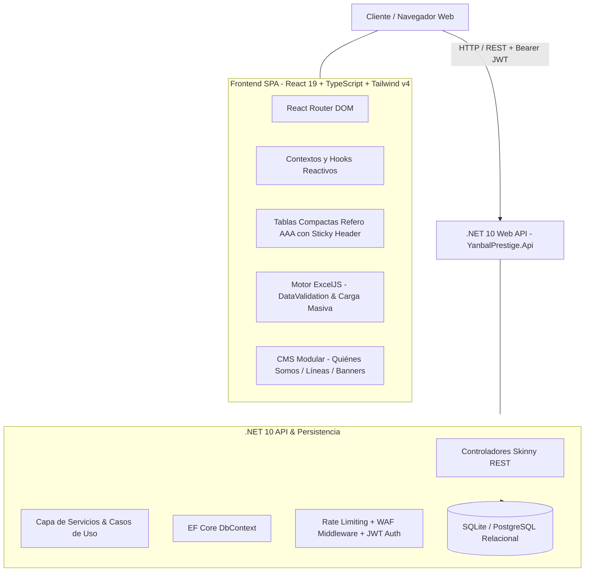

# 💎 Yanbal Prestige — Plataforma Web & CRM de Gestión de Red

Plataforma empresarial de comercio, gestión de red y fidelización para consultoras, líderes de zona y directoras de belleza Yanbal. Diseñada bajo la filosofía de minimalismo pragmático Ponytail, desacoplamiento estricto anti God-Class y estándares visuales de élite Refero AAA.

---

## 🏛️ Arquitectura del Sistema

---

## 🚀 Especificaciones Técnicas

| Componente | Tecnología / Versión | Descripción y Responsabilidad |
| :--- | :--- | :--- |
| **Backend API** | .NET 10 (C# LTS) | Web API modular con autenticación JWT, rate limiting perimétrico y EF Core. |
| **Frontend SPA** | React 19 + TypeScript + Vite | Interfaz ultra fluida, Tailwind CSS v4, componentes atómicos `<150` líneas. |
| **Motor de Tablas** | Refero AAA / Tailwind Grid | Tablas de alta densidad con encabezados sticky, paginación reactiva y zero scroll horizontal. |
| **Importación Masiva** | ExcelJS (`.xlsx`) | Generación y lectura de hojas de cálculo con validación de celdas (`DataValidation`), dropdowns y resolución difusa de IDs. |
| **Seguridad & WAF** | Middleware C# | Protección contra bots de mutación (`POST/PUT/DELETE`), honeypots y sanitización. |

---

## 👥 Roles en la Red y Jerarquía

1. **Directora:** Gestión centralizada de toda la red, métricas globales de facturación, administración de CMS y catálogo general.
2. **Asistente:** Soporte administrativo a la dirección, altas de red y validación de pedidos.
3. **Líder de Zona:** Supervisión y acompañamiento a su grupo de consultoras, seguimiento de metas y aprobaciones.
4. **Consultora:** Venta por catálogo, cotización rápida SKU para WhatsApp, gestión de clientes particulares y seguimiento de pedidos.

> [!NOTE] **Enfoque Universal e Inclusivo**
> Toda la terminología del sistema (formularios, plantillas Excel y mensajes en pantalla) utiliza referencias universales y neutras para cualquier persona que trabaje en la red de comercialización.

---

## 🌟 Funcionalidades y Módulos Principales

### 1. Catálogo Rápido SKU (Tabla Interactiva Refero AAA)
- Reemplazo de cuadrículas pesadas de tarjetas por una tabla compacta de alta densidad.
- Filtros por categoría (`Todos`, `Tratamiento Facial`, `Maquillaje`, `Perfumes`, etc.).
- Búsqueda reactiva por SKU o nombre de producto.
- Acción de copiado de código SKU con 1 clic al portapapeles.
- Botón **Cotizar** que abre directamente WhatsApp Web/Móvil con mensaje pre-redactado hacia el cliente.
- Paginación integrada de 15 productos por página.

### 2. Carga Masiva de Usuarios con Listas Desplegables en Excel (.xlsx)
- Generación dinámica de plantillas `.xlsx` mediante **ExcelJS**.
- **Data Validation en Celdas:**
  - Dropdown para **Rol en la Red** (`CONSULTORA`, `LIDER_ZONA`, `ASISTENTE`, `DIRECTORA`).
  - Dropdown dinámico con **Líderes Reales** obtenido en vivo desde la base de datos (evita que el usuario deba recordar o digitar códigos técnicos como `usr-3`).
- **Hoja 2 (Directorio):** Glosario de líderes activos con su zona asignada.
- **Mapeador Inteligente:** Si el usuario selecciona el nombre `"Andrea Gómez"`, el parser lo asocia automáticamente al `leaderId` correspondiente.

### 3. CMS Modular y Editor de Contenido
- **¿Quiénes Somos?:** Edición de historia corporativa, tarjeta de valores y línea de tiempo histórica (Timeline) con hitos agregables y eliminables.
- **Líneas de Producto:** Administración de colecciones destacadas con selección de productos por dropdown o rotación automática/aleatoria.
- **Navegación Parametrizada:** Pestañas enlazadas directamente por query params (`?tab=lineas`, `?tab=quienes-somos`) para auditoría visual directa.

### 4. QA Visual con Chromium CDP Nativo
- Inspección en vivo mediante el panel integrado de Antigravity (`antigravity-native-browser`).
- Captura de viewports Desktop (1440px) y Mobile (390px).
- Detección y corrección de desbordamientos visuales, solapamientos tipográficos y scrolls infinitos.

---

## 🔗 Enlaces y Repositorios

- **Repositorio Git:** `yanbal-prestige`
- **Estrategia de Ramas:** 3 ramas estrictas (`development` ➔ `qa` ➔ `main`).
- **Documentación Técnica Local:** `yanbal-prestige/docs/BITACORA_QA_VISUAL_Y_OPTIMIZACIONES_2026-11-08.md`.
- **Nota de Conocimiento:** [[QA_Visual_Nativo_Excel_Data_Validation_y_Tablas_Refero|Patrones de QA Visual y Excel DataValidation]].
