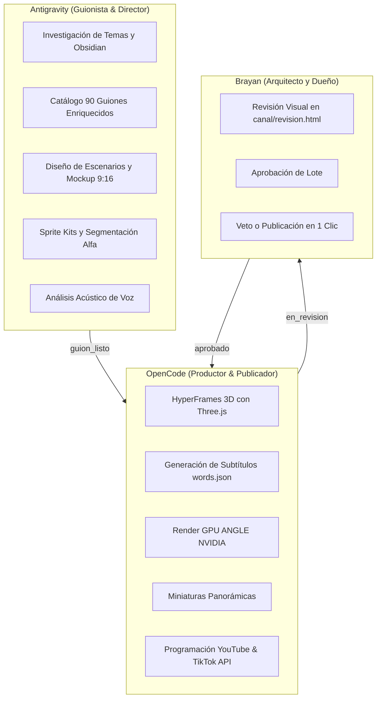

# 🤖 Coexistencia Multi-Agente: Protocolo Operativo Antigravity + OpenCode + Codex

Este documento recoge la **experiencia técnica, lecciones aprendidas, resolución de fallos críticos y patrones de diseño** derivados del trabajo simultáneo de múltiples agentes de IA (Antigravity de Google y OpenCode impulsado por Claude/Codex) sobre el repositorio `youtube-autopilot`.

---

## 🧭 1. El Desafío: Dos Agentes Autónomos en el Mismo Código

Cuando dos o más agentes intervienen de forma autónoma en un proyecto de software, surgen riesgos de:
1. **Sobrescritura destructiva:** Un agente elimina o reemplaza funciones que el otro acaba de implementar.
2. **Bloqueo de archivos en Windows (`WinError 32`):** Procesos concurrentes (como renderizado de video o compilaciones) intentando acceder al mismo descriptor de archivo.
3. **Inconsistencias arquitectónicas:** Un agente usando MoviePy clásico y otro usando HyperFrames con Three.js sin delimitación clara.

---

## 🛡️ 2. Las 6 Reglas de Oro de Coexistencia Multi-Agente

### Regla 1: Principio de Escritor Único (Single Writer Principle)
* Cada archivo o subsistema tiene **un único agente propietario con permiso de escritura**.
* **Antigravity (Guionista & Director de Escena):**
  - Escribe en: `guiones_90_videos_tecnologia.md`, `.agents/automations/`, guías de arte conceptual y scripts de segmentación de sprites.
* **OpenCode (Productor Técnico & Publicador):**
  - Escribe en: `hyperframes-studio/**`, `autopilot/**`, `canal/shorts/**` (`hf.json`, `miniatura.jpg`, `youtube.json`).
* **Archivos Compartidos (`config.py`, `COORDINACION.md`):** Edición quirúrgica y siempre documentada en la bitácora común antes y después de intervenir.

### Regla 2: Bitácora Viva de Coordinación (`COORDINACION.md`)
* En la raíz de todo repositorio multi-agente debe existir un archivo `COORDINACION.md`.
* Antes de que un agente inicie una tarea, **debe leer `COORDINACION.md`**.
* Al culminar su turno, **debe registrar qué cambió, en qué archivo y qué deja pendiente para el otro agente**.

### Regla 3: Aislamiento de Procesos de Renderizado y Salidas
* **Caso real vivido:** Al ejecutar MoviePy en paralelo con HyperFrames, ambos competían por el códec H.264 de FFmpeg en carpetas compartidas, dejando archivos corruptos con el error `[mov,mp4] moov atom not found`.
* **Solución:**
  - Versión A (MoviePy / Antigravity) renderiza exclusivamente en `output/` y `output/library/`.
  - Versión B (HyperFrames / OpenCode) renderiza exclusivamente en `hyperframes-studio/renders/`.

### Regla 4: Resiliencia Multi-Proveedor de Modelos (Anti-429 y Quota Exhaustion)
* **Incidente OpenCode (2026-11-05):**
  - OpenCode quedó congelado en la tarea de TikTok al usar `deepseek-v4.1-flash-free` (límite de peticiones `FreeUsageLimitError: 429`).
  - Al hacer fallback a `gemini-3.5-flash-lite`, agotó la cuota gratuita de 250.000 tokens de entrada, provocando la terminación abrupta de la sesión (`failed`).
* **Lección Arquitectónica:**
  - Ningún pipeline de automatización headless debe depender de un solo modelo gratuito.
  - Implementar siempre el **Smart AI Router** con cascada transparente:
    $$\text{Gemini API (Primario)} \longrightarrow \text{Groq Qwen 27B (Secundario Rápido)} \longrightarrow \text{OpenRouter Nemotron / Cohere (Fallback Gratuito)}$$

### Regla 5: Blindaje UTF-8 en Entornos Windows (Anti-Charmap)
* **Problema común:** Python en Windows intenta decodificar usando la página de códigos local (ANSI / CP1252), lanzando:
  `UnicodeEncodeError: 'charmap' codec can't encode character '\u2192'` al imprimir flechas `→`, alertas `⚠` o emojis en consola.
* **Solución Obligatoria:**
  1. En `config.py`:
     ```python
     import sys
     if hasattr(sys.stdout, 'reconfigure'):
         sys.stdout.reconfigure(encoding='utf-8', errors='replace')
         sys.stderr.reconfigure(encoding='utf-8', errors='replace')
     ```
  2. En scripts batch y PowerShell:
     `$env:PYTHONUTF8 = '1'` y `chcp 65001 > nul`.

### Regla 6: Gobernanza Estricta de Cuotas de APIs Externas
* **YouTube Data API v3:**
  - Cuota global: 10.000 unidades/día. Cada subida cuesta ~1.600 unidades (+50 por miniatura).
  - **Límite estricto implementado:** Máximo 5 videos por día (`max_n = 5`). Si ya se subieron videos hoy, el sistema se detiene y espera a las 00:00 PST (03:00 AM Colombia) para reanudar.
* **TikTok Content Posting API v2:**
  - Para aplicaciones en estado de auditoría (`Under Review`), la API rechaza publicaciones públicas directas (`PUBLIC_TO_EVERYONE`).
  - **Solución implementada:** Enviar el video como **Borrador a la Bandeja de Entrada** (`inbox/video/init/`). Esto transfiere el video al smartphone de Brayan con el texto listo, requiriendo solo 1 toque para publicar sin infringir políticas.

---

## 🎨 3. Dirección de Arte y Sprites Modulares (Anti-AI Slop)

Uno de los grandes descubrimientos del proyecto fue descartar la generación de video cuadro a cuadro por IA generativa (Sora/Runway), ya que deformaba el rostro y la vestimenta de Brayan entre escenas.

### La Solución Implementada:
1. **Modelado de Identidad:** Concept sheets basados en las fotos reales de Brayan con su buzo verde (`#1E3A2F`), gorra negra y visor cian.
2. **Hojas de Animación y Poses (Sprite Kits):** 6 poses de Brayan + 12 estados de personajes secundarios (Byte, Monolito, Glitch, Bot Scraper, Elena).
3. **Corte y Transparencia Alfa:** Script automatizado (`slice_sprites.py`) que genera 18 archivos PNG transparentes limpios.
4. **Composición con HyperFrames & GSAP:**
   - La imagen del personaje es 100% idéntica en los 90 videos.
   - Las poses cambian por eventos de la línea de tiempo (`brayan_pointing`, `brayan_panic_facepalm`).
   - Render en GPU a 60 FPS en menos de 40 segundos.

---

## 🎙️ 4. Análisis Acústico y Autenticidad Vocal

En lugar de utilizar locutores comerciales genéricos que desconectan de la audiencia técnica, se analizó la voz real de Brayan (`brayan_voice_sample.ogg`):
* **Frecuencia Fundamental:** 120 Hz – 142 Hz (Barítono medio / tenor ligero).
* **Cadencia:** 116 WPM (conversacional, cálido, educado, acento colombiano andino).
* **Calibración Edge-TTS:** `es-CO-GonzaloNeural` (`rate="+2%"`, `pitch="-1Hz"`).
* **Regla de Guion:** Empezar siempre con su saludo natural: *"Hola, ¿cómo vas?"*, incorporando pausas reflexivas y lenguaje técnico honesto.

---

## 📋 5. Resumen del Reparto de Tareas Multi-Agente


