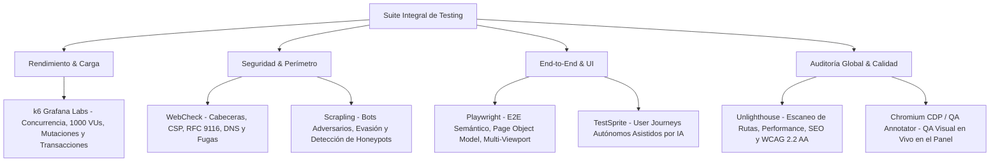

# 🧪 Ecosistema de Testing y Verificación Forense (k6, WebCheck, Playwright, Unlighthouse)

Guía y estándares técnicos del ecosistema multi-herramienta de pruebas de rendimiento, seguridad perimétrica, accesibilidad y pruebas de extremo a extremo (E2E), implementado y validado en **Yanbal Prestige**.

---

## 🏛️ Matriz de Herramientas y Propósito



---

## 1. 🚀 k6 (Grafana Labs) — Carga, Concurrencia y Resiliencia Backend

Evalúa el comportamiento del backend bajo estrés masivo, concurrencia extrema y ataques de fuerza bruta.

### Capacidades Validadas:
- **Suite Extrema (1,000 Virtual Users concurrentes):** Prueba de estrés de saturación y capacidad máxima de respuesta sin caídas del servicio Kestrel (.NET 10).
- **Suite de Ciclo de Vida Completo (`full-lifecycle-all-entities.test.js`):**
  - **1,601 checks aprobados de 1,601 (100.00% éxito)**.
  - Creación atómica de facturas consecutivas (`FAC-202611-XXXX`).
  - Validación de pagos y abonos en base de datos relacional.
  - Alta de postulaciones de empleo con consentimiento informado de Habeas Data (Ley 1581).
  - Mitigación activa de fuerza bruta (códigos `401 Unauthorized` y `429 Too Many Requests`).
  - Verificación del bloqueo inmediato de bots maliciosos con trampa Honeypot (`400 Bad Request`).

### Comandos de Ejecución en `package.json`:
```bash
# Ejecución estándar de suite k6
npm run test:k6

# Prueba extrema con 1,000 VUs
npm run test:k6:extreme

# Validación de ciclo de vida completo de todas las entidades
npm run test:k6:lifecycle
```

---

## 2. 🛡️ WebCheck & Blindaje Perimétrico

Auditoría perimétrica de seguridad sobre dominios y endpoints públicos (`https://web-check.xyz/`).

### Puntos Clave de Blindaje:
- **Content-Security-Policy (CSP) Estricto:** Restricción de orígenes para scripts, estilos, imágenes y fuentes (Google Fonts, Unsplash, Cloudflare Turnstile). Bloqueo de inyección XSS y ejecución no autorizada.
- **X-Content-Type-Options: `nosniff`:** Previene ataques basados en MIME-sniffing.
- **X-Frame-Options: `DENY`:** Inmunidad contra Clickjacking e incrustación maliciosa en iframes.
- **Referrer-Policy: `strict-origin-when-cross-origin`:** Protege URLs con parámetros sensibles en navegación externa.
- **Permissions-Policy:** Restricción total de sensores de hardware innecesarios (`camera=(), microphone=(), geolocation=(), payment=()`).
- **Cross-Origin-Opener-Policy (COOP) & Cross-Origin-Resource-Policy (CORP):** Aislamiento de contextos de navegación y entrega segura de recursos estáticos.
- **security.txt (RFC 9116):** Publicación del archivo estándar en `/.well-known/security.txt` con canales de reporte de vulnerabilidades y clave PGP.
- **Social Tags:** Metadatos completos OpenGraph (OG) y Twitter Cards para preview empresarial seguro.

---

## 3. 🕷️ Scrapling — Simulación Adversarial Anti-Bots

Herramienta de scraping y evaluación de defensas activas para probar la resistencia contra scrapers avanzados que simulan huellas de navegadores reales.

### Validaciones Implementadas:
- Comprobación de neutralización de scrapers automáticos en endpoints de mutación (`POST`, `PUT`, `DELETE`).
- Activación de trampas invisibles (**Honeypots**) camufladas fuera del viewport con `position: absolute; left: -9999px; opacity: 0; pointer-events: none;`.
- Si el bot completa el campo señuelo, el backend registra el intento en `auditoria_eventos` con la IP atacante y aborta con `400 Bad Request` antes de tocar stock o inventario.

---

## 4. 🎭 Playwright — Pruebas E2E con Selectores Semánticos

Pruebas automatizadas de interfaz simulando flujos reales de usuario bajo el patrón Page Object Model (POM).

### Estándares de Implementación:
- **Selectores Semánticos Resilientes:** Prohibido usar selectores frágiles como `div > div:nth-child(3)`; obligatorio `getByRole('button', { name: /confirmar/i })`, `getByLabel()` o `getByPlaceholder()`.
- **Validación Multi-Viewport:**
  - Desktop: 1440 × 900 px.
  - Tablet: 768 × 1024 px.
  - Mobile: 390 × 844 px (iPhone 13/14).
- **Flujos E2E Clave:** Búsqueda y filtrado en catálogo, agregado al carrito, checkout con mensaje pre-redactado para WhatsApp, y formulario de postulación a la red.

---

## 5. 💡 Unlighthouse & TestSprite — Calidad Web 360° e IA

- **Unlighthouse (`@unlighthouse/cli`):** Escaneo global de todas las rutas del sitio (`http://127.0.0.1:5173`) sin necesidad de correr Lighthouse URL por URL manualmente. Genera un dashboard interactivo con métricas agregadas de **Performance, Accesibilidad (WCAG 2.2 AA), SEO y Buenas Prácticas**.
- **TestSprite (`https://www.testsprite.com/`):** Agente autónomo de pruebas de software que recorre la UI, infiere los user journeys y genera pruebas automáticas contra regresiones funcionales sin requerir mantenimiento continuo de scripts.

---

## 6. 👁️ Chromium CDP / QA Annotator — QA Visual en Vivo

Control del navegador integrado en el panel de Antigravity mediante Chrome DevTools Protocol (`native_browser_*`):
- Inspección directa de componentes en ejecución sin abrir instancias duplicadas de Chrome ni Playwright headless que bloqueen terminales.
- Interacción con el usuario mediante el panel **Inspector** para recopilar feedback visual geolocalizado en el DOM.

---

## 🔗 Referencias Relacionadas
- [[00_Centro_de_Mando|Centro de Mando]]
- [[Yanbal Prestige|Proyecto Yanbal Prestige]]
- [[Testing y Calidad de Software|Testing y Calidad de Software]]
- [[Blindaje Anti-Bots y Proteccion de Recursos|Blindaje Anti-Bots y WAF]]
- [[QA_Visual_Nativo_Excel_Data_Validation_y_Tablas_Refero|QA Visual Nativo y Excel Data Validation]]
