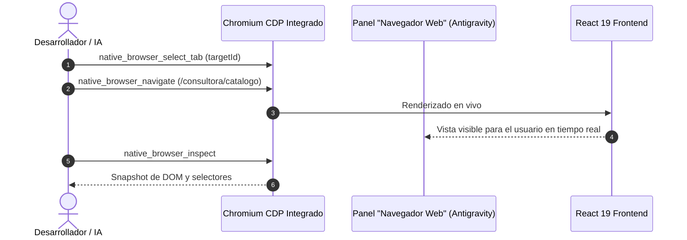

# 🧪 QA Visual Nativo, Excel Data Validation y Tablas Refero AAA

Este documento consolida los patrones técnicos de arquitectura frontend, automatización de pruebas visuales y generación de archivos Excel descubiertos y perfeccionados durante la optimización de **Yanbal Prestige**.

---

## 1. QA Visual en Vivo con Chromium CDP Nativo

### El Problema de las Herramientas Externas
El uso de navegadores externos (`start chrome`, Playwright o Puppeteer en subprocesos) genera colisiones de puertos, sobrecarga de memoria en Windows y desconexión con el panel interactivo del usuario.

### El Protocolo Nativo
Antigravity App incorpora un sidecar de Chromium administrado por CDP (Chrome DevTools Protocol) accesible mediante las herramientas `antigravity-native-browser`:
- `native_browser_list_tabs`: Lista las pestañas abiertas con su `targetId` y URL.
- `native_browser_select_tab`: Selecciona la pestaña activa sin abrir ventanas flotantes.
- `native_browser_navigate`: Dirige la sesión al endpoint exacto (ej. `http://127.0.0.1:5173/admin?tab=lineas`).
- `native_browser_inspect`: Captura el estado visual y del DOM.



### Trampa del Inspector y Solución
Cuando el panel **Inspector** está activado para que el usuario señale elementos y deje comentarios de QA, inyecta un overlay de captura que bloquea la propagación de eventos (`pointer-events: all`).
- **Regla:** Antes de ejecutar clics o interacciones programáticas, deshabilitar temporalmente el inspector con `native_browser_disable_inspector`.
- Tras finalizar la navegación o ajuste de vista, volver a activar con `native_browser_enable_inspector` para devolver el control al usuario.

---

## 2. Generación de Excel con Validación de Datos en Celdas (ExcelJS)

### Error Común de Sintaxis en `dataValidation`
Al configurar listas desplegables en ExcelJS, es un error común pasar cadenas simples en el arreglo `formulae`:
```typescript
// ❌ INCORRECTO: Excel lo interpreta como referencia a rango de celdas inexistente
cell.dataValidation = {
  type: 'list',
  allowBlank: true,
  formulae: ['CONSULTORA,LIDER_ZONA,ASISTENTE,DIRECTORA']
};
```

### Implementación Correcta con Comillas Internas
Excel requiere que las listas de texto literales vayan envueltas en **comillas dobles escapadas dentro de la cadena**:
```typescript
// ✅ CORRECTO: Genera dropdown nativo funcional en Microsoft Excel y LibreOffice
cell.dataValidation = {
  type: 'list',
  allowBlank: true,
  formulae: ['"CONSULTORA,LIDER_ZONA,ASISTENTE,DIRECTORA"'],
  showErrorMessage: true,
  errorTitle: 'Rol no válido',
  error: 'Seleccione un rol permitido de la lista desplegable.'
};
```

### Inyección de Entidades Dinámicas (Líderes de Zona)
Para evitar que los usuarios tengan que recordar o digitar códigos técnicos como `usr-3`:
1. El backend o frontend consulta los líderes reales disponibles en la base de datos.
2. Se construye una lista de nombres formateados: `['"Sin Líder Asignado,Andrea Gómez,Yulieth Ospina"']`.
3. Se agrega una segunda pestaña/hoja en el libro Excel (`Directorio de Líderes`) con el detalle de cédula, zona y teléfono para consulta rápida del usuario.

---

## 3. Resolución Tolerante y Difusa de Nombres a IDs

Al parsear la hoja de cálculo importada, el código debe ser tolerante a variaciones de formato:
```typescript
export function resolveLeaderId(input: string, leaders: LeaderItem[]): string | undefined {
  if (!input) return undefined;
  const clean = input.trim().toLowerCase();
  
  // 1. Coincidencia directa por ID
  const byId = leaders.find(l => l.id.toLowerCase() === clean);
  if (byId) return byId.id;

  // 2. Coincidencia exacta por nombre completo
  const byName = leaders.find(l => l.name.toLowerCase() === clean);
  if (byName) return byName.id;

  // 3. Coincidencia parcial o formateada ("Andrea Gómez (usr-3)")
  const partial = leaders.find(l => clean.includes(l.name.toLowerCase()) || clean.includes(l.id.toLowerCase()));
  return partial?.id;
}
```

---

## 4. Arquitectura de Tablas de Alta Densidad Refero AAA

### Cards vs Tablas en Datos Operativos
- **Tarjetas (Cards):** Excelentes para vitrinas públicas de marketing (3 a 6 productos en pantalla), pero ineficientes para usuarios de negocio (consultoras y administradores) que necesitan procesar decenas de registros rápidamente.
- **Tablas Refero AAA:**
  - Encabezados con `position: sticky; top: 0;` con fondo sólido o sutilmente translúcido (`bg-stone-50/95 backdrop-blur-sm`).
  - Altura máxima acotada (`max-h-[600px]`) con `overflow-y-auto` para evitar que la página entera haga scroll infinito.
  - Botones de acción directa compactos (`p-1.5 rounded-lg border hover:bg-stone-100`).
  - Paginación estricta (10 a 15 filas por página) que mantiene el DOM liviano y garantiza 60 FPS en equipos de recursos modestos.

---

## 5. Diseño Neutro, Universal e Inclusivo

### Principio
En aplicaciones corporativas, los textos no deben asumir el género ni condicionar la identidad de los trabajadores.

| Antes (Sesgado) | Ahora (Universal y Profesional) |
| :--- | :--- |
| *Carga Masiva de Usuarias* | **Carga Masiva de Integrantes de la Red** |
| *Importa consultoras, líderes o directoras* | **Importa integrantes (consultoras, líderes o directores)** |
| *Confirmar Carga (5 usuarias)* | **Confirmar Importación (5 personas)** |
| *0 usuarias seleccionadas* | **0 personas seleccionadas** |

---

## 🔗 Referencias Relacionadas
- [[00_Centro_de_Mando|Centro de Mando]]
- [[Yanbal Prestige|Proyecto Yanbal Prestige]]
- [[Diseno_Web_UI_UX_Profesional|Diseño Web UI/UX Profesional y Refero AAA]]
- [[Testing y Calidad de Software|Testing y Calidad de Software]]
