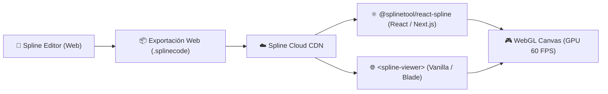

# 🧊 Spline 3D — Diseño Web Interactivo en Tiempo Real

- **Propósito:** Guía técnica, estándares de integración y buenas prácticas para la creación de interfaces web 3D interactivas con **Spline** ([spline.design](https://spline.design/)).
- **Relacionado:** [[00_Centro_de_Mando]], [[Catalogo de Skills (Antigravity)]], [[Frontend_Design_Engineering_UI_Skills]], [[Diseno_Web_UI_UX_Profesional]]
- **Skill Asociada:** `spline-3d-design`

---

## 🌟 1. ¿Qué es Spline 3D?

Spline es la herramienta de diseño 3D más potente orientada a la web, apodada en la industria como *"el Figma del 3D"*. A diferencia de suites tradicionales densas (Blender, Cinema 4D, Maya), Spline corre de forma nativa en el navegador, genera archivos optimizados de WebGL y permite exportar escenas interactivas como componentes de React, Next.js, Vue o Vanilla Web Components.

### Ventajas Clave:
1. **Curva de Aprendizaje Acelerada:** Interfaz minimalista similar a Figma, ideal para diseñadores y desarrolladores frontend.
2. **Interactividad Nativa sin Código:** Creación de eventos *On Hover*, *On Click*, seguimiento del cursor (*Mouse Look*), scroll interactivo y simulaciones físicas de gravedad y colisiones.
3. **Materiales de Última Generación:** Renderizado en tiempo real de cristal esmerilado (*glassmorphism*), metales reflectantes, gradientes iridiscentes y sombras suaves.
4. **Spline AI:** Generación de mallas 3D estilizadas a partir de texto (Text-to-3D), mapas de textura por IA y asistencia en composición de escenas.
5. **Manipulación Bidireccional:** El frontend puede leer variables del 3D y a la vez disparar animaciones o cambiar estados del objeto 3D desde código JavaScript/TypeScript.

---

## 🏗️ 2. Arquitectura de Integración en el Frontend



---

## 💻 3. Implementación en Código

### A. React / Next.js con Carga Perezosa (Lazy Loading)
```tsx
import React, { Suspense, useRef } from 'react';
const Spline = React.lazy(() => import('@splinetool/react-spline'));

interface SplineInteractiveCardProps {
  sceneUrl: string;
}

export function SplineInteractiveCard({ sceneUrl }: SplineInteractiveCardProps) {
  const splineRef = useRef<any>(null);

  function onLoad(splineApp: any) {
    splineRef.current = splineApp;
  }

  function handleExternalTrigger() {
    if (splineRef.current) {
      // Disparar evento de animación en el objeto nombrado en Spline
      splineRef.current.emitEvent('mouseHover', 'CardObject');
    }
  }

  return (
    <div className="relative w-full h-[450px] rounded-2xl bg-slate-900/40 border border-white/10 backdrop-blur-xl overflow-hidden shadow-2xl">
      <Suspense fallback={
        <div className="flex h-full w-full items-center justify-center text-sm text-slate-400">
          <div className="h-5 w-5 animate-spin rounded-full border-2 border-cyan-500 border-t-transparent mr-2" />
          Inicializando escena 3D...
        </div>
      }>
        <Spline scene={sceneUrl} onLoad={onLoad} className="w-full h-full" />
      </Suspense>
    </div>
  );
}
```

### B. Web Component Nativo (HTML / Blade / PHP)
```html
<script type="module" src="https://unpkg.com/@splinetool/viewer@latest/build/spline-viewer.js"></script>

<div style="width: 100%; height: 500px; position: relative;">
  <spline-viewer 
    loading-anim-type="spinner-small-light" 
    url="https://prod.spline.design/TU_ID_DE_ESCENA/scene.splinecode">
  </spline-viewer>
</div>
```

---

## ⚡ 4. Matriz de Rendimiento WebGL (Garantía 60 FPS)

| Parámetro | Recomendado Desktop | Recomendado Mobile | Impacto si se Excede |
| :--- | :--- | :--- | :--- |
| **Vértices / Polígonos** | < 50,000 | < 20,000 | Caída de framerate en GPUs integradas. |
| **Luces Dinámicas con Sombra** | Máximo 2 | Máximo 1 (o solo baked) | Alto consumo de batería y saturación de shader passes. |
| **Pase de Post-procesado (Blur/Bloom)** | Moderado | Desactivado | Caída a <30 FPS en dispositivos móviles gama media. |
| **Pointer Events** | `auto` (solo si es interactivo) | `none` (si es solo fondo) | Lag al hacer scroll con el dedo en pantallas táctiles. |

---

## ⚖️ 5. Comparativa Técnica: Spline vs. Blender

* **Usa Spline cuando:**
  - Necesitas una experiencia 3D viva en una página web en cuestión de horas.
  - Quieres que la escena reaccione al ratón, clicks o scroll del usuario sin programar matrices Three.js.
  - Buscas estética moderna, glassmorphism, sombras suaves y maquetas de producto tipo Apple o Linear.
* **Usa Blender cuando:**
  - Estás desarrollando activos o niveles para **Aurora Engine** (Godot 4).
  - Requieres mallas de altísimo detalle, simulación física compleja, escultura digital o esqueletos de personajes avanzados (rigging IK/FK).
  - La salida final es un render offline ultra-realista con Cycles o un asset `.glb` ultra-optimizado con retopología manual.

---

> 💡 **Cómo activar en Antigravity:** Pide: *"Crea un Hero interactivo 3D con Spline para el Portafolio"* o *"Diseña un visualizador de producto con Spline en React"*, y el agente activará automáticamente la skill `spline-3d-design` para generar los componentes y directrices optimizados.
